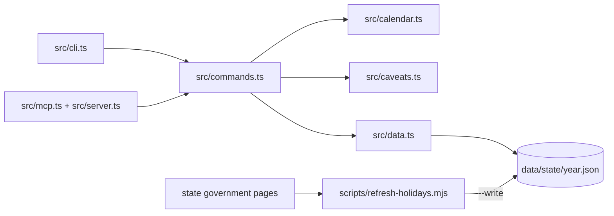

# au-bizdays: how it is built

A TypeScript ESM package compiled with tsc to `dist/`, shipping two binaries over one shared core: the `au-bizdays` CLI and the `au-bizdays-mcp` stdio MCP server. Both answer from holiday tables bundled in `data/`; nothing runs as a service and nothing touches the network at run time. Maintenance scripts in `scripts/` refresh the data and cut releases, driven by GitHub Actions. <!-- src: package.json#bin, package.json#type, tsconfig.json, SECURITY.md -->

## Components

- `src/cli.ts`: argument parser, per-command help, human or `--json` output, exit codes 0, 2 (usage) and 3 (outside the data). <!-- src: src/cli.ts:23-86, src/cli.ts:163-194 -->
- `src/mcp.ts` and `src/server.ts`: the MCP entry point on stdio and the eight tools, all annotated read-only, each returning the command's JSON as structured content plus a one-line text summary. <!-- src: src/mcp.ts, src/server.ts:13, src/server.ts:39-58 -->
- `src/commands.ts`: the eight operations shared by both front ends. Each validates loosely typed arguments and returns an `au-bizdays/v1` envelope (input, result, assumptions, caveats). <!-- src: src/commands.ts:1-42 -->
- `src/calendar.ts`: pure business-day arithmetic over a calendar built from one state's data, and the `UsageError` and `CoverageError` types. <!-- src: src/calendar.ts:1-60 -->
- `src/caveats.ts`: the standing caveats (business-day definition, regional holidays not counted) and the ones a result earns (estimated and part-day holidays touched, data ending within 60 days). <!-- src: src/caveats.ts -->
- `src/date.ts` and `src/clock.ts`: calendar dates as day numbers, and the clock for `today`, read on the state capital's timezone. <!-- src: src/date.ts:1-2, src/clock.ts -->
- `src/render.ts`: the human text and the MCP one-liner for an envelope. <!-- src: src/render.ts -->
- `src/index.ts`: the library exports (`dist/index.js` is `main`). <!-- src: src/index.ts, package.json#main -->
- `scripts/refresh-holidays.mjs` with parsers in `scripts/lib/parse.mjs`: fetch each state page, parse it to the data shape, diff against `data/`, optionally write. Not part of the published package. <!-- src: scripts/refresh-holidays.mjs:1-19, package.json#files, SECURITY.md -->
- `scripts/release.mjs`: plans and writes release notes for the publish workflow. `scripts/render-demo.mjs`: regenerates the output blocks in the README and docs. `scripts/check-text.mjs`: the em dash check. <!-- src: scripts/release.mjs:1-13, scripts/render-demo.mjs:1-6, scripts/check-text.mjs -->

## Data flow

- A CLI call is parsed in `src/cli.ts`, checked against the command's allowed options, then run as a command with a `Context` holding today's date and a `todayIn(state)` function. <!-- src: src/cli.ts:163-180 -->
- An MCP `tools/call` goes to a custom handler in `src/server.ts` (not the SDK's argument check), so the arguments reach the same command function and errors return the CLI's text as a tool error. <!-- src: src/server.ts:39-58, src/server.ts:124-132 -->
- The command parses the state, dates (`today` resolved on the state's clock), numbers and choices, loads and caches the state's calendar, runs the arithmetic, and wraps the result with assumptions and caveats. <!-- src: src/commands.ts:44-130 -->
- A date outside the bundled years raises `CoverageError` and no answer is given. <!-- src: src/calendar.ts:50-60 -->
- Monthly, the `refresh-holidays` workflow runs the refresh script with `--write --allow-blocked` and opens a pull request when `data/` changed; it never pushes to the default branch. <!-- src: .github/workflows/refresh-holidays.yml -->
- A push to main that changes package.json (or a manual run) starts `publish`, which publishes to npm with provenance and cuts a GitHub Release when npm lacks the version; with no `NPM_TOKEN` and nothing on npm yet it ends green with a notice. <!-- src: .github/workflows/publish.yml, scripts/release.mjs:7-12 -->

## Storage

- `data/<state>/<year>.json`, 2025 to 2028 for each of the eight states: `source_url`, `retrieved_on`, optional `estimate_basis`, and holidays with date, name, scope (`statewide`, `part-day`, `regional`) and status (`confirmed`, `estimated`). Validated on load; years must be contiguous. <!-- src: src/data.ts:7-71, docs/data.md -->
- Parsed calendars are cached in memory per process. Nothing is written at run time. <!-- src: src/data.ts:38, src/commands.ts:90-98, SECURITY.md -->

## Auth

- None at run time: the CLI and the MCP server are local processes with no accounts. The refresh workflow's token can open pull requests and cannot push to the default branch. <!-- src: src/mcp.ts, SECURITY.md, .github/workflows/refresh-holidays.yml -->

## External services

- None at run time. <!-- src: SECURITY.md, src/data.ts -->
- The refresh script fetches the state government pages and the data.gov.au holiday CSV listed in `SOURCES`, with a 30 second timeout and a User-Agent naming the repo. <!-- src: scripts/refresh-holidays.mjs:35-58 -->
- The publish workflow talks to the npm registry (`NPM_TOKEN` secret, or npm trusted publishing over OIDC) and GitHub Releases through `gh` with the workflow token. <!-- src: .github/workflows/publish.yml:7-14, .github/workflows/publish.yml:62-80 -->

## Unverified

- None.
